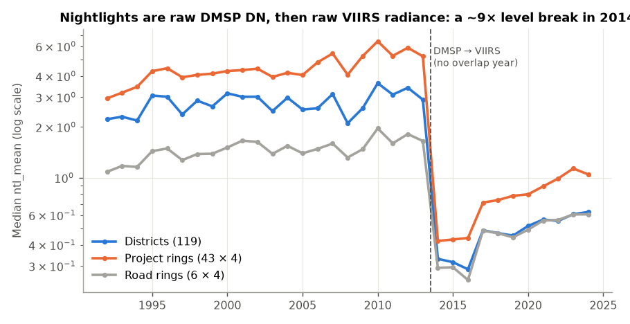
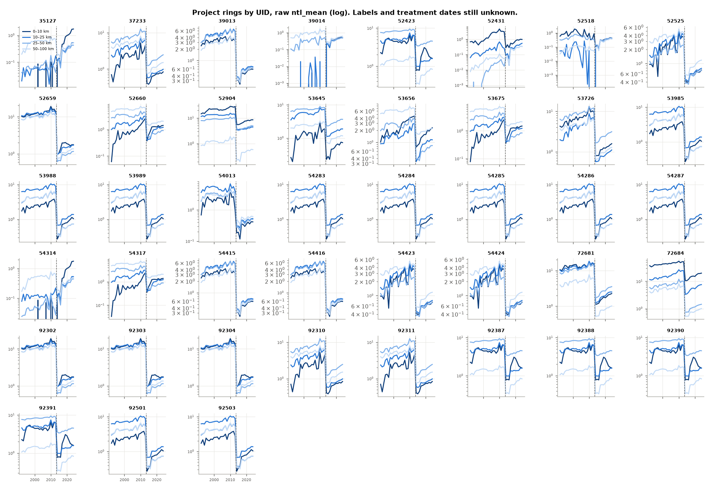
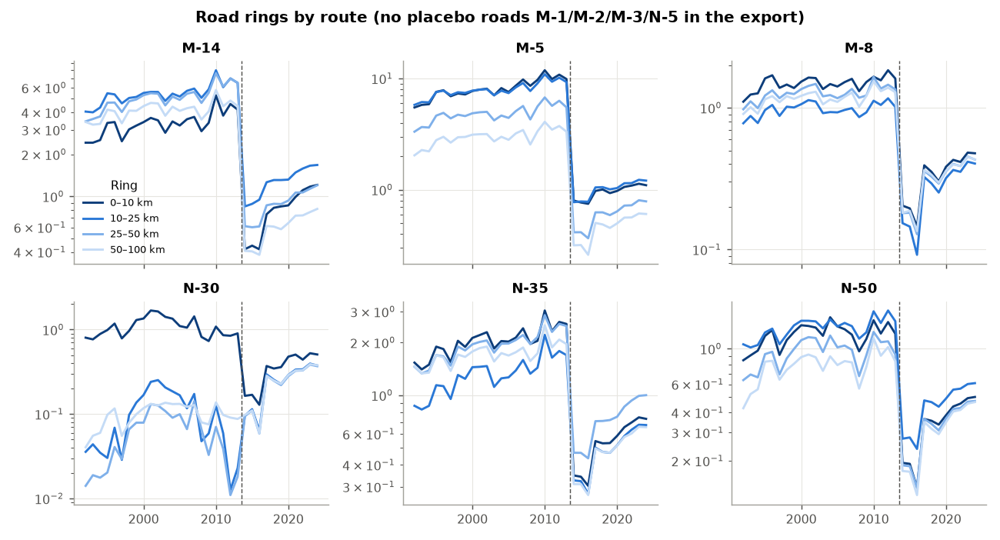
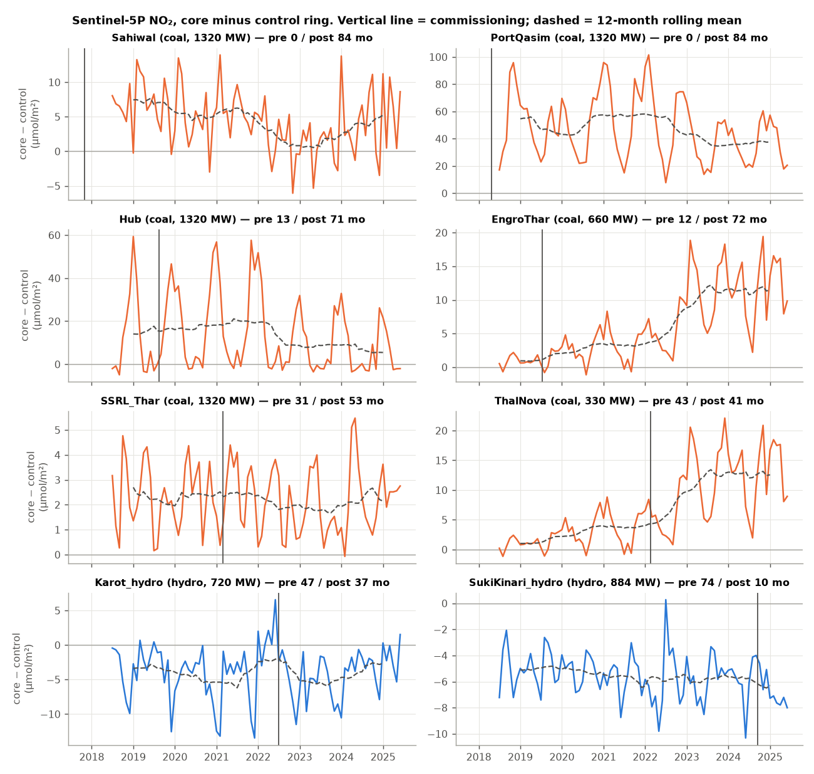

# CPEC satellite data: Week 1–2 audit

Scope: the five Google Earth Engine exports (files 1, 2, 3, 4, 6). The plan was to verify the
data before estimating anything. This document records what that turned up and how it changes
the plan. Reproduce with `python src/01_audit.py` and `python src/02_no2_diagnostics.py`
(the raw CSVs go in `data/raw/`; they are not committed because this repository is public).

## Summary

| # | Finding | Severity | Consequence |
|---|---|---|---|
| 1 | Nightlights are raw DMSP (1992–2013) followed by raw VIIRS (2014–2024), with **no overlap year and no harmonisation**. The median cell falls ~9× (Δlog −2.0 to −2.2) in 2014. Cross-cell correlation is 0.994 from 2012 to 2013 but only **0.73** from 2013 to 2014. | **Blocking** for any pre/post comparison across 2014 | Year fixed effects cannot absorb it: the sensor switch re-ranks cells, it does not shift them all equally. |
| 2 | The 43 project UIDs sit at only **21 distinct locations**. One point carries 10 UIDs, others 5, 4 and 3 each. 18 of the 21 clusters are byte-identical series. | **Blocking** until the crosswalk is done | Effective N is ≤21, and probably lower. Stacked UIDs at one point look like AidData records geocoded to a city or admin centroid, not to a project footprint. |
| 3 | Project UIDs have **no labels and no treatment dates** in the file. | **Blocking** | No project estimate is possible yet. A template is ready at `data/crosswalk/project_uid_crosswalk_TEMPLATE.csv`. |
| 4 | The road file has **only the 6 CPEC roads**. The placebo set (M-1, M-2, M-3, N-5) is not in the export. | **Blocking** for the road DiD | Re-export the placebo roads with the same ring code. |
| 5 | **No coordinates were exported**: `.geo` is an empty MultiPoint in every row of all five files. Ring radii for the NO₂ core and control rings are not recorded. | High | Overlap between sites and wind-direction work cannot be checked from these files. |
| 6 | NO₂: **Sahiwal and Port Qasim have 0 pre-months**, because they were commissioned before Sentinel-5P starts in July 2018. Hub and Engro have only 12–13 pre-months. | High | Only 2–3 coal sites can identify a commissioning effect. |
| 7 | NO₂: **EngroThar and ThalNova are the same footprint** (core-ring correlation 1.00). ThalNova's "pre-period" is entirely after Engro's commissioning. | High | Treat Thar Block II as **one site with staggered capacity**: 660 MW (Jul 2019), then +330 MW (Feb 2022). |
| 8 | District files use **119 pre-2010 districts** (NWFP and FATA names), not the 86 LFS units. | Medium | A district-to-LFS crosswalk is needed before linking to the LFS. Template: `data/crosswalk/district119_to_lfs86_TEMPLATE.csv`. |
| 9 | DMSP is top-coded: **42 district-years at DN 63** (saturated city cores). | Medium | Levels in big cities are censored in the pre-period. |
| 10 | Built-up area comes in 5-year epochs, so the only post-CPEC observations are **2020 and 2025**. It never decreases (0 districts in any epoch), which suggests a modelled, monotone product (probably GHSL). | Medium | Confirm whether the 2025 epoch is observed or a GHSL projection. If it is projected, only 2020 is a real post-CPEC observation. |

No duplicate keys, no missing values, and all panels are balanced.

## 1. Nightlights: the sensor break

DMSP is in digital numbers (0–63, saturating); VIIRS is radiance in nW/cm²/sr. The two are not
on the same scale, and their relationship is non-linear. DMSP blooms outward from lit areas and
saturates in cities; VIIRS does neither. That means **the ring gradient itself changes at 2014**:
in DMSP, blooming makes outer rings look brighter relative to the core than they are. Almost
every CPEC commissioning date is 2015 or later. So any `Post × Ring` coefficient estimated
across 2014 compares a DMSP pre-period against a VIIRS post-period, and it would pick up the
sensor change as a "treatment effect".

**Recommended fix (in order of preference):**

1. **Primary specification: VIIRS only, 2014–2024.** No harmonisation is needed. Projects
   commissioned in 2017 or later get at least 3 pre-years. For the few with earlier dates, the
   event study simply has fewer leads.
2. **Re-export VIIRS starting in 2012.** Annual VNL v2 and the monthly VCMCFG product start
   in April 2012, which gives two overlap years with DMSP F18 (2012–2013). That allows an
   in-sample calibration, and a check on it.
3. **Re-export a harmonised series for the long pre-period**, e.g. the Li et al. (2020)
   harmonised DMSP–VIIRS product, which I believe is in the GEE community catalogue under
   `projects/sat-io/open-datasets/Harmonized_NTL` (not verified). Use DMSP only to show 20-year
   pre-trends; do not use it to estimate effects.

## 2. Project rings: the UID problem

`output/audit/project_site_clusters.csv` lists the clusters:

| Site | UIDs | Identical? |
|---|---|---|
| S16 | 53985, 53988, 53989, 54283–54287, 92501, 92503 (10) | yes |
| S05 | 52423, 92387, 92388, 92390, 92391 (5) | yes |
| S09 | 52659, 92302, 92303, 92304 (4) | yes |
| S03 | 39013, 54415, 54416 (3) | yes |
| S02 | 37233, 92310, 92311 (3) | near (Δlog 0.003) |
| S08 | 52525, 54423, 54424 (3) | near (Δlog 0.005) |

The other 15 UIDs are singletons. S09's rings run at DN 10–20 before 2014, which
suggests a major city. When filling the crosswalk, record AidData's **geographic precision
code** for each UID. Any UID geocoded to a city, district or province centroid should be dropped
from the ring design: a 0–10 km ring around a centroid is not "near the project". Also decide
whether multiple UIDs at one real site are **one treatment** (take the earliest date) or
**stacked doses**.

## 3. Roads

With 6 roads and no placebo set, the road design cannot be run. Even with the placebo roads,
this is 6 treated units against 4 controls. Standard errors need wild-cluster bootstrap or
randomisation inference, and the result is better presented as a case-level synthetic-control
or SDID exercise than as a regression with clustered SEs. N-30 is almost unlit outside its
0–10 km ring, so logs there will be driven by near-zero noise; use `asinh` or levels as a
robustness check.

## 4. NO₂

`output/no2/site_inventory.csv` and `output/no2/site_prepost_contrasts.csv` hold the numbers.
The contrasts below are **diagnostic only**: site-level OLS with month-of-year dummies and HAC
standard errors, and no meteorology.

| Site | Pre / post months | Core − control, post vs pre (µmol/m²) | Log-ratio | Read |
|---|---|---|---|---|
| Thar Block II (EngroThar = ThalNova) | 12 / 72 | +5.9 (SE 1.6) | +0.23 | **Clear rise.** Mean gap: 0.95 before Jul 2019 → 2.7 (Jul 2019–Jan 2022) → 4.9 (2022) → 11.8 (2023–25) |
| SSRL Thar (Block I) | 31 / 53 | −0.3 (0.2) | −0.02 | No effect. Fake-date placebo is also ≈0. |
| Hub | 13 / 71 | −0.8 (2.3) | +0.03 | No detectable effect. Winter spikes of 40–60 dominate; the Karachi plume correlates 0.81 with Port Qasim. |
| Karot (hydro placebo) | 47 / 37 | −0.0 (0.7) | −0.01 | Clean placebo. |
| Suki Kinari (hydro placebo) | 74 / 10 | −0.8 (0.3) | −0.22 | Only 10 post-months; the fake-date placebo is also negative, so read this as noise or trend. |

What this means for Paper 2:

- **Thar Block II is the strongest single result in all five files.** The gap rises in steps
  that line up with capacity additions: Engro 660 MW in 2019, ThalNova 330 MW in Feb 2022,
  and also Thar Energy (TEL) 330 MW in late 2022, which is not in this file but is in the same
  block. That staircase is a dose-response pattern, which is more convincing than a single
  pre/post jump. The main confounder is that **the Block II open-pit mine expanded over the
  same years**: mine haulage and excavation also emit NO₂. It has to be addressed, either by
  mine output data or by using the mine as a separate treatment.
- **SSRL shows nothing** at 1,320 MW. Either the core ring is not on the plant (the
  coordinates can't be verified; see finding 5), or the plant ran at low load. Check the
  coordinates first.
- **Sahiwal's gap collapses to 1.9 in 2022 and 0.7 in 2023, then recovers to 4.0–6.3.** This
  is consistent with imported-coal plants being curtailed during the 2022–23 coal-price and
  FX-payment crisis; that is a hypothesis to check against NEPRA monthly generation data. If
  it holds, it gives an identification strategy for the two plants that have no pre-period: use
  **monthly plant generation (GWh) as a continuous treatment**, identified off utilisation
  shocks that are driven by world coal prices rather than local conditions. That is arguably a
  better design than binary commissioning for all six coal plants.
- The seasonal cycle (`output/no2/fig2_seasonality.png`) is larger than most plant effects.
  Month-of-year controls are required, and meteorology (ERA5 wind, BLH) should come next.

## 5. What to change in the plan

1. **Paper 1 (nightlights):** a VIIRS-only 2014–2024 event study is the primary specification.
   Nothing is estimated until (a) the UID crosswalk is filled with precision codes and
   commissioning dates, (b) centroid-geocoded UIDs are dropped, and (c) duplicates are collapsed
   to sites. Expect around 15–20 usable sites, not 43.
2. **Road design:** re-export M-1, M-2, M-3 and N-5 with identical ring code. Use SDID or
   synthetic control per road, with randomisation inference.
3. **Paper 2 (NO₂):** reframe around (a) Thar Block II as a capacity-staircase case study and
   (b) a plant-generation intensity design covering all six coal plants. Hydro stays as the
   placebo. Add meteorology and, for the Sahiwal and Port Qasim pre-period, MODIS AOD from 2000.
4. **Re-exports needed from GEE:** placebo roads; VIIRS for 2012–2013 (or harmonised NTL);
   point coordinates for every UID and plant (export the `.geo` geometry, or add lat/lon
   properties); NO₂ ring radii.
5. **Data you hold offline that are needed:** AidData GCDF v3 (to fill the crosswalk; the
   download was blocked from this environment), cpec.gov.pk commissioning dates, and NEPRA
   monthly generation by plant.
